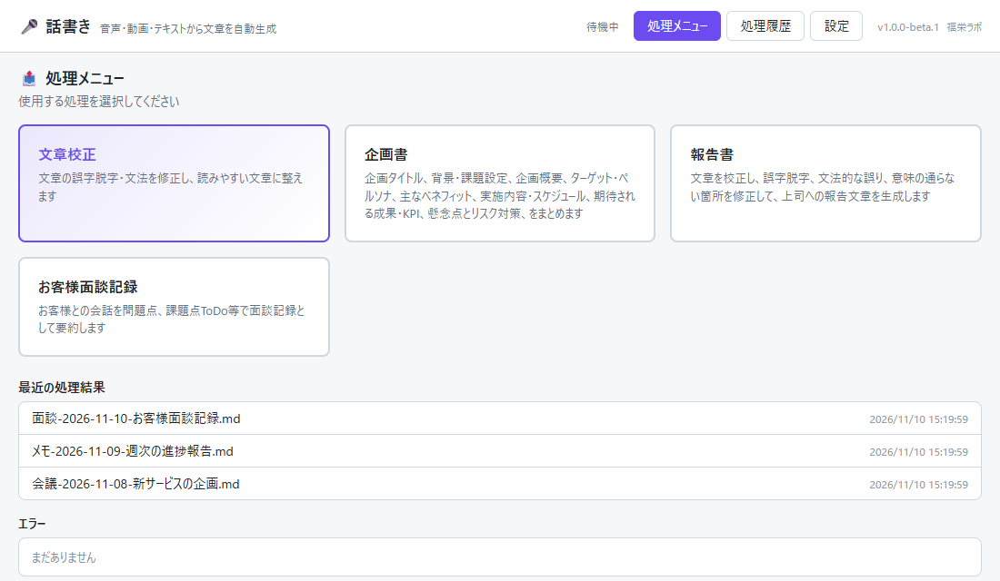
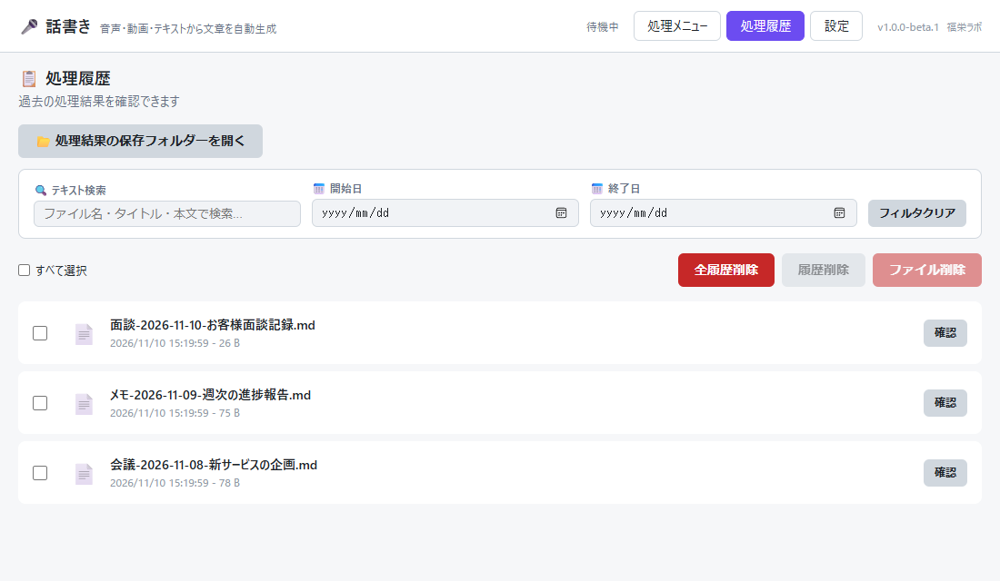
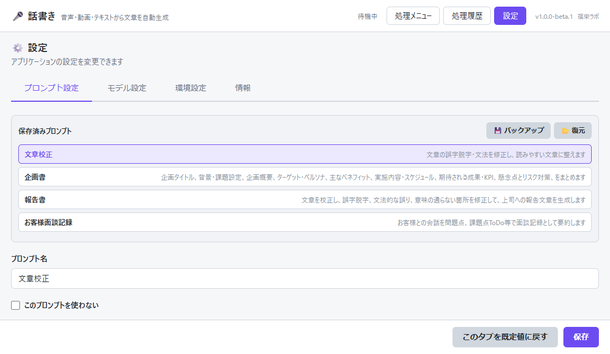

<div align="center">

# 話書き (Voice2Doc)

**音声・動画ファイルやテキストから、校正済みの文章・企画書・報告書・お客様面談記録を、あなたの Windows PC 上で自動生成します。**

[](LICENSE)


[English](README.md) | 日本語

</div>

話書きは、音声・動画ファイルを **Whisper** でローカル文字起こしし、LLM（**Gemma 4**）が、編集できるプロンプトに沿って
文章校正・企画書・報告書・お客様面談記録などの目的の文章に整えるアプリです。テキストを貼り付けたり `.txt` / `.md` ファイルをドロップして、
文字起こしを省くこともできます。結果は検索できる履歴に残り、**テキスト(.txt)・Word(.docx)・PDF・Markdown** で
ダウンロードできます。

## 紹介動画

話書きでできることと使い方を、約2分で紹介する動画です。サムネイルをクリックすると、YouTube で見られます。

| 日本語 | English（英語） |
|:---:|:---:|
| [](https://youtu.be/CuGJ9sUqLIM) | [](https://youtu.be/kJETnFES1AQ) |
| [YouTube で見る](https://youtu.be/CuGJ9sUqLIM) | [Watch on YouTube](https://youtu.be/kJETnFES1AQ) |

> **テスト版（プレリリース）です。** 現在のバージョンは正式版 1.0.0 の前のテスト版 `1.0.0-beta.3` です。機能は一通り揃っていますが、不具合が残っている可能性があります。
>
> **画面は日本語と英語に対応しています。** 初回起動ウィザードが Windows の言語から選び、「設定 → 環境設定 → 言語」でいつでも切り替えられます。編集していない初期プロンプトと音声認識の言語も、選んだ言語に合わせて入れ替わります。
>
> **Vibe が最優先で必要です。** vibe-server.exe と FFmpeg は同梱していません。両方を含む [Vibe](https://github.com/thewh1teagle/vibe/releases) を、ページ下の **Assets** にある Windows 用インストーラー（例: `vibe_3.3.2_x64-setup.exe`。2026年11月13日時点の、Intel・AMD の CPU の Windows 用の名前です。数字の部分は新しい版で変わります）で入れてください。入れると Vibe が音声認識モデルを自動でダウンロードし、終わったら Vibe の画面は × で閉じて構いません。

## 特長

- 音声・動画ファイル（WAV / MP3 / M4A / MP4 / MOV など。1回に最大10ファイル・合計1GBまで）の**ドラッグ＆ドロップ**
  （プロンプトカードへ直接ドロップすることもできます）、**テキストの直接入力・貼り付け**（入力した本文も結果と同じ名前の `.txt` で残ります）、
  `.txt` / `.md` のドロップに対応
- **プロンプトカードで作る文章を選択**: 文章校正（既定）・企画書・報告書・お客様面談記録の4つを内蔵。独自のプロンプト、出力フォルダ、
  文字起こし結果の付与有無を追加・編集できます。使わないプロンプトは「このプロンプトを使わない」で処理メニューから隠せます。
  保存済みプロンプトはまとめて**バックアップ**（ダウンロードフォルダへ JSON で保存）・**復元**できます
- **ローカル文字起こし**（Whisper）: [vibe-server.exe](https://github.com/thewh1teagle/vibe)（whisper.cpp、Vulkan GPU 対応）または `openai-whisper`
- **ローカル LLM**（llama-cpp-python で Gemma 4 E2B を PC 上で実行）。GPU（AMD・Intel・NVIDIA。Vulkan 対応）があれば自動で使い、無い・合わない場合は CPU で動きます（グラフィックスドライバーは最新にしてください。設定の「モデル」タブの「LLM の実行装置」で CPU / GPU に固定もできます）。文字起こしも文章の生成も PC の外に出ません
  → [プライバシー](#プライバシー)
- **処理履歴**: 全文検索・プレビュー・コピー・削除
- **必要な形式でダウンロード**: `.txt`（UTF-8 BOM・CRLF。メモ帳でも文字化けしません）、`.docx`（見出し・箇条書き・太字）、
  `.pdf`（日本語フォントを埋め込み、Word 不要）、`.md`。既定の形式は「設定 → 環境設定」で変更できます
- **初回起動ウィザード**が前提ソフト（VC++ Runtime / WebView2 / FFmpeg / vibe-server.exe）を確認
- ユーザー単位でインストール。**管理者権限は不要**

## 画面

| 処理メニュー | 処理履歴 | 設定 |
| --- | --- | --- |
|  |  |  |

## 仕組み

```
音声・動画 ──ffmpeg──▶ Whisper (vibe-server.exe) ──▶ 文字起こし ─┐
                                                      ├─▶ LLM + プロンプト ──▶ Markdown ──▶ 処理履歴
貼り付けテキスト / .txt / .md ─────────────────────────┘                                      │
                                      .txt / .docx / .pdf / .md でダウンロード ◀──────────────┘
```

## 動作環境

| 項目 | 備考 |
| --- | --- |
| Windows 10 / 11（64bit） | 対応 OS |
| [Vibe](https://github.com/thewh1teagle/vibe/releases) | **各自でインストールしてください（同梱していません）。** 音声認識の `vibe-server.exe` と `ffmpeg.exe` を提供し、アプリが自動検出します |
| Microsoft Edge WebView2 Runtime | 画面表示に使用。Windows 11 と多くの Windows 10 では導入済み。未導入ならインストーラーが取得します |
| Visual C++ Redistributable | 未導入ならインストーラーが取得します |
| ディスク空き容量 | アプリ本体 約0.9GB ＋ Whisper モデル **1.6GB**（Vibe がダウンロード）＋ ローカル LLM **2.6GB**（初回利用時にアプリがダウンロード）。**7GB 以上**を推奨 |
| インターネット（初回） | Whisper モデル（Vibe が取得）とローカル LLM、上記の前提ソフトのダウンロードに必要 |

インストーラーには vibe-server.exe・FFmpeg・Whisper モデル・Gemma 4 モデルは**含まれていません**。vibe-server.exe と `ffmpeg.exe` は
Vibe（`%LOCALAPPDATA%\vibe\`）のものを使い、既定の Whisper モデルは Vibe が自分でダウンロードします。ローカル LLM は初回利用時にアプリが
Hugging Face からダウンロードし、別の Whisper モデルは、設定で選んで確認ダイアログで「ダウンロード」を押したときだけアプリがダウンロードします。

## インストール

下の手順を、Microsoft Edge でのダウンロードからアプリのメイン画面が出るまで、約5分の動画で説明しています。

| 日本語 | English（英語） |
|:---:|:---:|
| [](https://youtu.be/HNJr572inao) | [](https://youtu.be/skiT6SxcPdM) |
| [YouTube で見る](https://youtu.be/HNJr572inao) | [Watch on YouTube](https://youtu.be/skiT6SxcPdM) |

1. まだであれば [Vibe](https://github.com/thewh1teagle/vibe/releases) をインストールします（**Assets** の `vibe_3.3.2_x64-setup.exe` を実行。モデルのダウンロードが終わったら Vibe の画面は × で閉じて構いません）。
2. リポジトリの [**Releases** ページ](https://github.com/fukueilab/Voice2Doc/releases) の最新版を開き、**Assets** から `Voice2Doc-Setup.exe`（約300MB）をダウンロードします。
3. 実行してウィザードに従います。インストール先は `%LOCALAPPDATA%\Voice2Doc` で、管理者権限は不要です。
   最後のページに、音声認識に Vibe を使うことと、Vibe が未導入なら初回起動時に導入することが表示されます。「**Voice2Doc を起動する**」にチェックが入っているので、そのまま「完了」を押すとアプリが起動します。
4. デスクトップまたはスタートメニューの **Voice2Doc** から起動します。初回起動ウィザードが開きます。前提条件のページで4項目がすべて「準備完了」になるまで「次へ」は押せません（Vibe がまだ無ければ、ここでも案内します。「再確認」または「vibe-server.exe の場所を指定する」で、アプリを再起動せずに認識させられます）。
   モデルのダウンロードが終わるまで待ってから文字起こしを行ってください。

> **Microsoft Edge でのダウンロード**: インストーラーは新しく、コード署名もないため、Edge が「一般的にダウンロードされていません」と表示して
> 保存しないことがあります。これは Edge の評判チェックで、ウイルスと判定されたわけではありません。ダウンロードの一覧で、ファイルの横の
> **「…」（その他の操作）→「保存」** を押し、確認が出たら「保持する」を選んでください（表示は Edge のバージョンで少し違います）。
> Firefox と Chrome では、そのままダウンロードできます。
>
> **Windows SmartScreen**: インストーラーはコード署名されていないため、「Windows によって PC が保護されました」と表示される
> ことがあります。このリポジトリの [Releases](https://github.com/fukueilab/Voice2Doc/releases) からダウンロードしたものなら、**詳細情報 → 実行** で進めてください。
>
> **スマート アプリ コントロール（Windows 11）**: 有効な PC では、署名のないアプリが管理者権限でも実行できず、許可する方法もありません。
> 導入するには「設定 → プライバシーとセキュリティ → Windows セキュリティ → アプリとブラウザーの制御 → スマート アプリ コントロールの設定」で
> オフにする必要があります。多くの Windows のバージョンでは、一度オフにすると Windows のリセット（再インストール）をしない限りオンに
> 戻せないため、よく検討してください。詳しくは[インストール手順書](docs/install-guide.md#5-トラブルシューティング)を参照してください。

詳細とトラブルシューティング: [docs/install-guide.md](docs/install-guide.md)（[English](docs/install-guide.en.md)）

> ⚠️ **アンインストールすると、設定・処理履歴・キャッシュしたモデルを含む `%LOCALAPPDATA%\Voice2Doc` が丸ごと削除されます**
> （既知の制限）。事前に `config.json` と生成結果を退避してください。

## 使い方

1. スタート画面でプロンプトカード（文章校正・企画書・報告書・お客様面談記録・自作）を選びます（カードへファイルを直接ドロップしてもかまいません）。
2. 音声・動画ファイルをドロップするか、テキストを貼り付ける（またはテキストファイルをドロップする）して開始します。
3. 処理が終わると**処理履歴**が開きます。項目を開き、**テキスト / Word / PDF / Markdown** を選んで**ダウンロード**を押すと、
   `ダウンロード` フォルダに保存されます。
4. プロンプト、モデル、既定のダウンロード形式は**設定**で変更できます。モデル設定タブの「AIモデルの指定」には、
   ダウンロード済みの任意の `.gguf` ファイルのパスを指定できます（既定の `gemma4:e2b-qat(llama.cpp)` のままなら内蔵モデルを使います）。
   「**情報**」タブには、バージョン・ライセンス・リンク・必要なソフトウェアを表示します。

設定は `%LOCALAPPDATA%\Voice2Doc\config.json`（インストール版）または `~\Documents\Voice2Doc\config.json`（ソース実行時）に保存され、
生成した Markdown は同じ場所の `output` フォルダに置かれます。

話書きは同時に1つだけ起動します。もう一度起動すると、起動済みのウィンドウが前面に出ます。
起動中は「起動しています…」の画面を表示します。画面が白いままのときは、自動で再読み込みし、それでも直らなければ GPU を使わない描画（「描画の安全モード」。
設定 → 環境設定 から通常に戻せます）で一度だけ起動し直し、最後に対処法を案内します。
ポート 8008 を他のソフトが使っているときは、8030 までの空きポートを自動で使います。
保存される結果は `元のファイル名-H1タイトル.md/.txt` という名前になります（結果に `#` 見出しが無いときは元のファイル名のみ）。

**ログ。** 起動のたびに、`config.json` と同じ場所の `logs` フォルダへ動作ログを出力します
（例: `logs\2026-10-28T21-22-31.log`、最新30件を保持）。不具合を報告するときに添付してください。
プロンプトや文字起こしの本文はログに含まれません。

## プライバシー

- 文字起こしも文章の生成も、すべて**お使いの PC 上**で行われます。音声・動画・文字起こし・生成結果が外部へ送信されることはありません。
- インターネットに接続するのは、Whisper モデルとローカル LLM のモデルファイルを Hugging Face から初回に一度だけダウンロードするとき
  （vibe-server.exe が無く `openai-whisper` で認識する場合は、そのモデルを OpenAI の配布元から取得します）と、
  インストーラー・初回起動ウィザードが前提ソフト（VC++ Runtime / WebView2）を Microsoft から取得するときだけです。

## ソースから実行

Windows と Python 3.12 が必要です。

```bash
git clone https://github.com/fukueilab/Voice2Doc.git
cd Voice2Doc
pip install -r requirements.txt
python main.py
```

- **vibe-server.exe と FFmpeg はリポジトリに含まれていません。** [Vibe](https://github.com/thewh1teagle/vibe/releases) をインストールしてください
  （`%LOCALAPPDATA%\vibe\` に `vibe-server.exe` と `ffmpeg.exe` が入り、アプリが自動検出します。別の場所は設定で指定できます）。
  vibe-server.exe が見つからない場合は Python 版 `openai-whisper` に自動フォールバックし、Vibe の `ffmpeg.exe` または
  `PATH` 上の `ffmpeg` を使います。
- `llama-cpp-python` はビルド済み wheel が使えない環境があります。`pip` がコンパイルする場合は
  Visual Studio Build Tools（C++ ワークロード）が必要です。

### 開発

```bash
python -m pytest src_backends/ -v                  # 全テスト
python scripts/ruff_baseline.py                    # lint: 新しい ruff 指摘が増えたときだけ失敗（CI と同じ）
```

バックエンドは FastAPI + Uvicorn（`src_backends/`）、デスクトップシェルは PyWebView（`main.py`）、フロントエンドはバニラ JS / HTML / CSS（`src/`）です。
アーキテクチャ・API・設定は [spec.md](spec.md) に、全体の概要は [docs/spec/voice2doc.md](docs/spec/voice2doc.md) にまとめています。

### ビルド

```bat
build.bat             :: PyInstaller  -> dist\Voice2Doc\Voice2Doc.exe
build_installer.bat   :: PyInstaller + NSIS -> dist\Voice2Doc-Setup.exe
```

ビルド前に外部のバイナリを置く必要はありません。インストーラーの作成には
[NSIS 3](https://nsis.sourceforge.io/) が `C:\Program Files (x86)\NSIS\` に必要です。PDF 用の日本語フォント（IPAex ゴシック）は
`fonts/` にあり、自動で同梱されます。

## コントリビュート

話書きは個人開発のプロジェクトです。Issue や提案は投稿できますが、お返事に時間がかかったり、すべてにはお答えできなかったりします。
プルリクエストも拒否はしませんが、プロジェクトの方針や保守の都合により、取り込めない場合があります。
大きな変更は、事前に Issue でご相談ください。[CONTRIBUTING.md](CONTRIBUTING.md) と [行動規範](CODE_OF_CONDUCT.md) も参照してください。

セキュリティ上の問題は [SECURITY.md](SECURITY.md) へ。バージョンは [Semantic Versioning](https://semver.org/lang/ja/)（プレリリース表記）に従います。
[CHANGELOG.md](CHANGELOG.md) を参照してください。

## 謝辞（Acknowledgements）

話書きの音声認識は、thewh1teagle さんが開発した [Vibe](https://github.com/thewh1teagle/vibe)（vibe-server）に支えられています。
Vibe の作者と貢献者の皆さん、そして FFmpeg、Whisper、whisper.cpp、llama.cpp、Gemma の開発者の皆さんに、心から感謝します。

## ライセンス

[MIT](LICENSE) © 2026 Fukuei Lab (福栄ラボ)

話書きは第三者のソフトウェアを同梱・利用しています。主なものは **fpdf2（LGPL-3.0）**、**IPAex ゴシック（IPA フォントライセンス v1.0）**、
PyTorch、Whisper、llama.cpp です。Vibe（vibe-server.exe、MIT）とそれに含まれる FFmpeg、Whisper と Gemma 4 のモデルは別途
インストール・ダウンロードされ、それぞれのライセンスに従います。すべて [THIRD_PARTY_NOTICES.md](THIRD_PARTY_NOTICES.md) に記載しています。

「Whisper」は OpenAI の、「Gemma」は Google LLC の商標です。話書きは独立したプロジェクトであり、これらの企業とは提携・承認関係にありません。

## 福栄ラボについて

話書きは、ITの困り事を個別対応する個人スタジオ **福栄ラボ (Fukuei Lab)** が作っています。
AI アシスタントの [Claude](https://www.anthropic.com/claude)（Anthropic）を使って開発しています。

- Web サイト: https://www.8asue.com/fukuei/
- YouTube: https://www.youtube.com/@fukueilab
