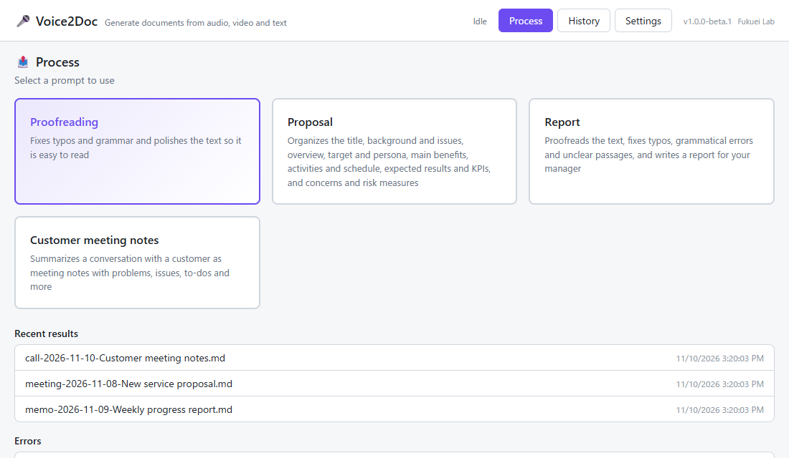
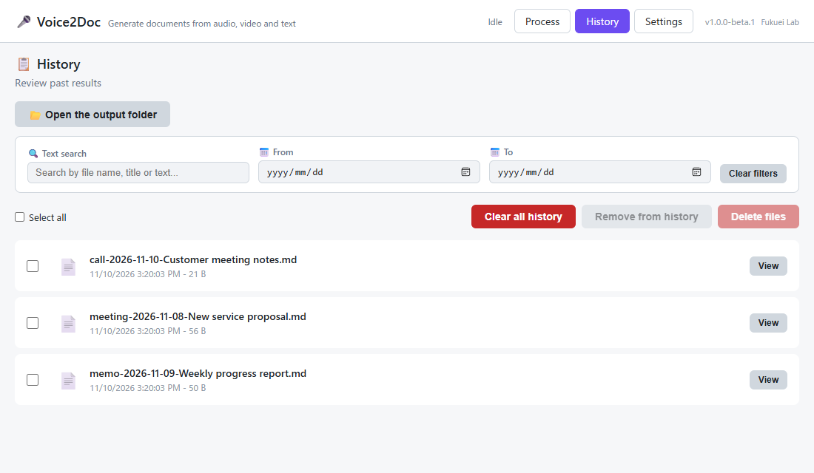
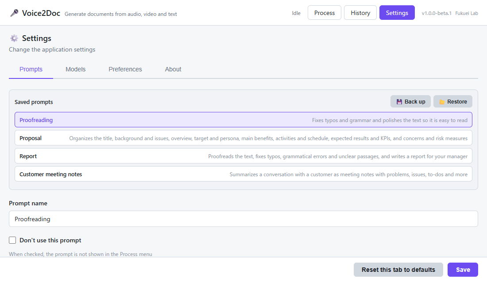

<div align="center">

# Voice2Doc (話書き)

**Turn voice and video recordings — or pasted text — into proofread text, proposals, reports and meeting notes, on your own Windows PC.**

[](LICENSE)


English | [日本語](README.ja.md)

</div>

Voice2Doc transcribes audio and video files locally with **Whisper**, then has an LLM (**Gemma 4**) turn the transcript
into the document you need — a proofread text, a proposal, a report for your manager or customer meeting notes —
using prompts you can edit.
You can also paste text or drop a `.txt` / `.md` file and skip the transcription. Results are kept in a searchable
history and can be downloaded as **plain text, Word (.docx), PDF or Markdown**.

## Introduction video

A short video (about 2 minutes) shows what Voice2Doc does and how to use it. Click a thumbnail to watch it on YouTube.

| English | 日本語 (Japanese) |
|:---:|:---:|
| [](https://youtu.be/kJETnFES1AQ) | [](https://youtu.be/CuGJ9sUqLIM) |
| [Watch on YouTube](https://youtu.be/kJETnFES1AQ) | [YouTube で見る](https://youtu.be/CuGJ9sUqLIM) |

> **Pre-release.** The current version is `1.0.0-beta.5`, a test build before the stable 1.0.0. Features are in place,
> but expect rough edges.
>
> **The interface is available in English and Japanese.** The first-run wizard picks the language from your Windows language;
> change it any time in *Settings → Preferences → Language*. Unedited built-in prompts and the speech recognition language follow it.
>
> **Vibe is required (top priority).** The app does not include vibe-server.exe or FFmpeg. Install
> [Vibe](https://github.com/thewh1teagle/vibe/releases), which provides both: download the Windows installer
> (for example `vibe_3.3.2_x64-setup.exe`, the name for Windows on Intel/AMD PCs as of 13 Nov 2026; the version number changes in newer releases) from **Assets** at the bottom of that page and run it. Vibe then downloads a speech
> recognition model by itself; when it finishes you can close the Vibe window with the ×.

## Features

- **Drag & drop** audio / video files (WAV, MP3, M4A, MP4, MOV, … up to 10 files / 1 GB at a time) — straight onto a prompt card
  if you like — or **type / paste text** (the typed text is saved as a `.txt` next to the result), or drop `.txt` / `.md` files
- **Pick what to produce** with prompt cards — four are built in: Proofreading (the default), Proposal, Report and
  Customer meeting notes (in Japanese: 文章校正, 企画書, 報告書, お客様面談記録);
  add and edit your own prompts, output folders and whether the transcript is appended. Hide prompts you don't need from
  the Process menu with "Don't use this prompt", and **back up / restore** all saved prompts (a JSON file in Downloads)
- **Local transcription** with Whisper: [vibe-server.exe](https://github.com/thewh1teagle/vibe) (whisper.cpp, Vulkan GPU) or `openai-whisper`
- **Local LLM** (Gemma 4 E2B run on your PC with llama-cpp-python) — neither the transcript nor the generated text leaves your PC;
  see [Privacy](#privacy). It uses your **GPU** (AMD, Intel or NVIDIA, through Vulkan) automatically when one is available and falls
  back to the CPU otherwise; keep the graphics driver up to date. You can pin it to the CPU or the GPU under Settings > Model > *LLM device*
- **History**: full-text search, preview, copy, delete
- **Download in the format you need**: `.txt` (UTF-8 BOM, CRLF — opens cleanly in Notepad), `.docx` (headings, bullets, bold, tables),
  `.pdf` (tables too; Japanese font embedded, no Word required) or `.md`. The default format is set in Settings → Preferences
- **First-run wizard** that checks prerequisites (VC++ Runtime, WebView2, FFmpeg, vibe-server.exe)
- Installs per user — **no administrator rights** needed

## Screenshots

| Process | History | Settings |
| --- | --- | --- |
|  |  |  |

## How it works

```
audio / video ──ffmpeg──▶ Whisper (vibe-server.exe) ──▶ transcript ─┐
                                                          ├─▶ LLM + your prompt ──▶ Markdown ──▶ History
pasted text / .txt / .md ─────────────────────────────────┘                                        │
                                              download as .txt / .docx / .pdf / .md ◀───────────────┘
```

## Requirements

| What | Notes |
| --- | --- |
| Windows 10 / 11 (64-bit) | Supported OS |
| [Vibe](https://github.com/thewh1teagle/vibe/releases) | **Install it yourself (not included).** It provides `vibe-server.exe` (speech recognition) and `ffmpeg.exe`, which the app finds automatically |
| Microsoft Edge WebView2 Runtime | Draws the app window. Pre-installed on Windows 11 and most Windows 10 PCs; the installer fetches it if missing |
| Visual C++ Redistributable | The installer fetches it if missing |
| Disk space | About 0.9 GB for the app, **1.6 GB** for the Whisper model (Vibe downloads it) and **2.6 GB** for the local LLM (the app downloads it on first use) — plan for **7 GB or more** |
| Internet (first run) | Needed to download the Whisper model (by Vibe), the local LLM, plus the prerequisites above |

The installer does **not** include vibe-server.exe, FFmpeg, the Whisper model or the Gemma 4 model. vibe-server.exe and
`ffmpeg.exe` come from Vibe (`%LOCALAPPDATA%\vibe\`), and Vibe downloads the default Whisper model itself. The app downloads the local LLM from
Hugging Face on first use, and a different Whisper model only when you choose it in Settings (after you confirm the download).

## Installation

A setup video (about 5 minutes) walks through every step below, from downloading in Microsoft Edge to the app's main screen.
The English version shows the Japanese screens; the captions give each button's English name next to the Japanese one.

| English | 日本語 (Japanese) |
|:---:|:---:|
| [](https://youtu.be/skiT6SxcPdM) | [](https://youtu.be/HNJr572inao) |
| [Watch on YouTube](https://youtu.be/skiT6SxcPdM) | [YouTube で見る](https://youtu.be/HNJr572inao) |

1. Install [Vibe](https://github.com/thewh1teagle/vibe/releases) if you have not yet (download `vibe_3.3.2_x64-setup.exe`
   from **Assets** and run it; close its window with the × after it finishes downloading the model).
2. Download `Voice2Doc-Setup.exe` from the [**Releases** page](https://github.com/fukueilab/Voice2Doc/releases) (open the newest version and look under **Assets**; about 300 MB).
3. Run it and follow the wizard. It installs to `%LOCALAPPDATA%\Voice2Doc` and needs no administrator rights.
   The last page says that Voice2Doc uses Vibe for speech recognition and that, if Vibe is not installed yet, you install
   it when the app first starts. **Launch Voice2Doc** is checked, so press **Finish** to start the app.
4. Start **Voice2Doc** from the desktop or Start menu shortcut. The first-run wizard opens. Its prerequisite page must show all four items as ready before **Next** is enabled; if Vibe
   is still missing it links to Vibe again, and **Check again** (or **Specify the location of vibe-server.exe**) picks it up
   without restarting the app. Wait for the model downloads to finish before transcribing.

> **Downloading in Microsoft Edge**: because the installer is new and not code-signed, Edge may say the file "isn't commonly downloaded"
> and not save it. This is Edge's reputation check, not a virus detection. In the download panel, click **… (More actions)** next to the
> file and choose **Keep** (保存), then confirm if asked (**Keep anyway**; the wording varies with the Edge version). Firefox and Chrome download it directly.
>
> **Windows SmartScreen**: the installer is not code-signed, so Windows may show "Windows protected your PC".
> Click **More info → Run anyway** if you downloaded it from this repository's [Releases page](https://github.com/fukueilab/Voice2Doc/releases).
>
> **Smart App Control (Windows 11)**: when it is on, it blocks unsigned apps with no way to allow them — not even with
> administrator rights. To install Voice2Doc you have to turn it off in *Settings → Privacy & security → Windows Security →
> App & browser control → Smart App Control settings*. On most Windows versions it cannot be turned back on without
> resetting or reinstalling Windows, so decide carefully. See the [installation guide](docs/install-guide.en.md#5-troubleshooting).

Details and troubleshooting: [docs/install-guide.en.md](docs/install-guide.en.md) ([日本語](docs/install-guide.md)).

> ⚠️ **Uninstalling removes `%LOCALAPPDATA%\Voice2Doc` including your settings, history and cached models**
> (known limitation). Copy `config.json` and your results first.

## Usage

1. Choose a prompt card on the start screen (Proofreading, Proposal, Report, Customer meeting notes, or your own) — or drop
   files right onto a card.
2. Drop audio / video files, paste text, or drop a text file. Press start.
3. When processing finishes the **History** page opens. Open an item, pick **Text / Word / PDF / Markdown**, and press
   **Download** — the file is saved to your `Downloads` folder.
4. Prompts, models and the default download format are in **Settings**. The *AI model* box on the model tab accepts the path of any
   downloaded `.gguf` file (leave it at the default `gemma4:e2b-qat(llama.cpp)` to use the built-in model).
   The **About** tab shows the version, license, links and the required software.

Settings are stored in `%LOCALAPPDATA%\Voice2Doc\config.json` (installed version) or
`~\Documents\Voice2Doc\config.json` (running from source). Generated Markdown goes to the `output` folder next to it.

Only one instance runs at a time: launching Voice2Doc again just brings the already-running window to the front.
While starting, the window shows a "Starting up..." screen. If the window stays blank, the app reloads it, then restarts once with
GPU acceleration turned off ("safe rendering mode"; you can turn it off again in Settings > Preferences), and finally shows guidance.
If port 8008 is used by another program, the next free port up to 8030 is used automatically.
Saved results are named `<source file name>-<H1 title>.md/.txt` (just the source name when the result has no `#` heading).

**Logs.** Every launch writes an activity log to the `logs` folder next to `config.json`
(for example `logs\2026-10-28T21-22-31.log`; the latest 30 are kept). Attach it when reporting a problem.
It never contains prompt or transcript text.

## Privacy

- Transcription and text generation both run entirely **on your PC**. Audio, video, transcripts and results are never sent anywhere.
- The app goes online only to download the Whisper model and the local LLM model from Hugging Face (once, on first use; when
  vibe-server.exe is missing and `openai-whisper` is used, its model comes from OpenAI's download server), and
  the installer and first-run wizard download the prerequisites (VC++ Runtime / WebView2) from Microsoft when they are missing.

## Run from source

Requires Python 3.12 on Windows.

```bash
git clone https://github.com/fukueilab/Voice2Doc.git
cd Voice2Doc
pip install -r requirements.txt
python main.py
```

- **vibe-server.exe and FFmpeg are not in the repository.** Install [Vibe](https://github.com/thewh1teagle/vibe/releases)
  (it puts `vibe-server.exe` and `ffmpeg.exe` in `%LOCALAPPDATA%\vibe\`, which the app finds; another location can be set in
  Settings). If vibe-server.exe is not found the app falls back to the Python `openai-whisper` backend, which uses Vibe's
  `ffmpeg.exe` or an `ffmpeg` on your `PATH`.
- `llama-cpp-python` ships wheels for some setups only. If `pip` has to compile it you need the
  Visual Studio Build Tools (C++ workload).

### Development

```bash
python -m pytest src_backends/ -v                  # all tests
python scripts/ruff_baseline.py                    # lint: fails only on NEW ruff findings (what CI runs)
```

Backend: FastAPI + Uvicorn (`src_backends/`), desktop shell: PyWebView (`main.py`), frontend: vanilla JS / HTML / CSS (`src/`).
The architecture, API and settings are documented in [spec.md](spec.md) (Japanese); an overview is in
[docs/spec/voice2doc.md](docs/spec/voice2doc.md).

### Build

```bat
build.bat             :: PyInstaller  -> dist\Voice2Doc\Voice2Doc.exe
build_installer.bat   :: PyInstaller + NSIS -> dist\Voice2Doc-Setup.exe
```

No external binaries need to be placed before building. The installer step needs
[NSIS 3](https://nsis.sourceforge.io/) at `C:\Program Files (x86)\NSIS\`. The Japanese PDF font (IPAex Gothic) is
in `fonts/` and is bundled automatically.

## Contributing

Voice2Doc is a personal project. Issues and suggestions can be posted, but replies may take a long time, and we may not
be able to answer every one. Pull requests are not refused either, but depending on the direction of the project and what we
can maintain, we may not be able to merge them. For larger changes, please open an issue to discuss the idea first.
See [CONTRIBUTING.md](CONTRIBUTING.md) and the [Code of Conduct](CODE_OF_CONDUCT.md).

For security issues, see [SECURITY.md](SECURITY.md). Versioning follows [Semantic Versioning](https://semver.org/) with
pre-release tags; see [CHANGELOG.md](CHANGELOG.md).

## Acknowledgements

Voice2Doc's speech recognition is supported by [Vibe](https://github.com/thewh1teagle/vibe) (vibe-server), developed by
thewh1teagle. Heartfelt thanks to the authors and contributors of Vibe, and to the developers of FFmpeg, Whisper,
whisper.cpp, llama.cpp and Gemma.

## License

[MIT](LICENSE) © 2026 Fukuei Lab (福栄ラボ)

Voice2Doc bundles and relies on third-party software — most importantly **fpdf2 (LGPL-3.0)**, **IPAex Gothic (IPA Font
License v1.0)**, PyTorch, Whisper and llama.cpp. Vibe (vibe-server.exe, MIT) and the FFmpeg it ships are installed separately,
as are the Whisper and Gemma 4 models; each follows its own license. Everything is listed in
[THIRD_PARTY_NOTICES.md](THIRD_PARTY_NOTICES.md).

"Whisper" is a trademark of OpenAI and "Gemma" a trademark of Google LLC. Voice2Doc is an independent project and is not
affiliated with or endorsed by them.

## About Fukuei Lab

Voice2Doc is made by **Fukuei Lab (福栄ラボ)**, an independent studio that helps with individual IT problems.
It is developed with the help of [Claude](https://www.anthropic.com/claude), an AI assistant by Anthropic.

- Website: https://www.8asue.com/fukuei/
- YouTube: https://www.youtube.com/@fukueilab
